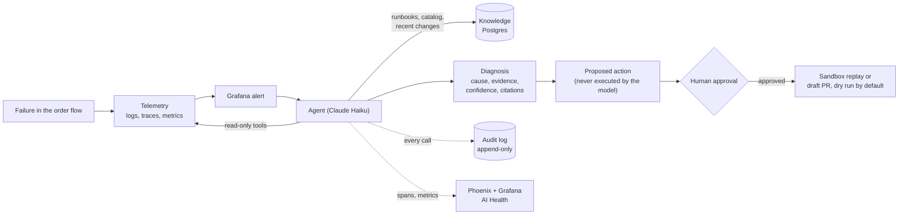

# Agentic incident response, with the AI governed and monitored

An AI agent that investigates integration failures in a simulated order flow (logs, traces, metrics, runbooks), reports a root cause with evidence and a confidence score, and proposes a fix that **a person must approve before anything happens**. Around it sits a platform that governs and monitors the agent itself: every call audited, guardrails in code, a kill switch, budgets, and evals that measure accuracy, cost, latency and whether its confidence can be trusted.

It is built to answer one question honestly: *what does an AI incident responder do well, what can't it do without your team's knowledge, and how do you keep it safe?*

> **Status and honesty.** The platform is built end to end and tested. The *content* it is evaluated on is a stand-in: the failures are a placeholder catalog and the runbooks and service catalog are drafts written by Claude Code from the simulator's behavior, not field experience. Treat the numbers as a demonstration of the method, not a benchmark. Details in [docs/eval-report.md](docs/eval-report.md).

## Results so far

Verified and repeatable: **252 tests pass**; a live **prompt-injection scenario passed 3 of 3** (instruction text planted in an order SKU never reached the model, nothing was approved or executed, diagnoses still completed); a diagnosis costs **about half a cent** and takes **15 to 30 seconds** on Haiku; the whole quick start below works end to end in containers.

**Not yet available: a valid full ablation** (arm A telemetry only versus arm B plus knowledge). Two full runs were lost to the machine running them (a network outage, then the laptop sleeping), and the content they use is placeholder and draft. [docs/eval-report.md](docs/eval-report.md) says what is solid, what is preliminary, and the exact command to finish. [docs/baseline-log.md](docs/baseline-log.md) records everything the live runs broke and what changed.

## What it does



Full business process, architecture, decisions and operations: [docs/solution-design.md](docs/solution-design.md). Diagrams alone: [docs/architecture.md](docs/architecture.md). Knowledge layer: [docs/knowledge-design.md](docs/knowledge-design.md). A live-run log with what the first real runs broke: [docs/baseline-log.md](docs/baseline-log.md).

## Quick start

You need Docker and an Anthropic API key (Claude is the only model used; it is reached through one gateway module).

```bash
cp .env.example .env
```

Edit `.env`: set `ANTHROPIC_API_KEY`, and set `AGENT_ADMIN_TOKEN` (generate one with `python3 -c "import secrets; print(secrets.token_urlsafe(24))"`). Then:

```bash
docker compose up -d --build
```

That starts the simulated order flow, the observability stack, Postgres, the trace viewer and the agent, and ingests the knowledge base. Open Grafana at <http://localhost:3000> (dashboards *Order Flow* and *AI Health*) and Phoenix at <http://localhost:6006>.

Break something and watch the agent respond (a demo script is in [docs/demo-script.md](docs/demo-script.md)):

```bash
docker compose exec agent-trigger python scripts/load.py --url http://order-service:8000 --rps 5 --seconds 180
```

```bash
docker compose exec agent-trigger python -m simulator.failure_injector.injector inject F03
```

About a minute later the real Grafana alert fires, calls the agent, and the diagnosis appears:

```bash
curl -s localhost:8004/diagnoses
```

Review proposed actions and use the kill switch at <http://localhost:8004/approvals/ui> (paste your admin token; it is sent as a header and never put in a URL).

## What is built

| Layer | What | Where |
|---|---|---|
| Simulated enterprise | Order and pricing services, RabbitMQ, 8 injectable failures | `simulator/`, `failures/catalog.yaml` |
| Platform observability | OpenTelemetry, Loki, Tempo, Prometheus, Grafana, alert rules | `observability/` |
| Agent core | Alert trigger, loop, model gateway, strict structured output | `agent/` |
| Tools and knowledge | MCP server: logs, traces, metrics, runbooks, service catalog, contracts, recent changes | `mcp_server/`, `knowledge_store/`, `knowledge/` |
| Governance | Audit log, guardrails, approval gate, kill switch, budgets | `agent/governed.py`, `guardrails.py`, `actions.py`, `audit.py`, `killswitch.py`, `admin_api.py` |
| Agent observability | OpenTelemetry GenAI spans to Phoenix; agent metrics and alert rules in Grafana | `agent/tracing.py`, `observability/` |
| Evaluation | Harness, blind judge, calibration, ablation, report | `evals/` |

## How the AI is governed

Every control below is enforced in code and covered by tests, including adversarial ones.

| Risk | Control |
|---|---|
| The model changes something it should not | Investigation tools are read-only. The model's only action tools *propose*. A person approves; execution is a dry run unless real execution is switched on too. Replay goes to a sandbox queue only; a draft PR can only add one markdown file under `proposed-fixes/`. |
| Log text tries to hijack the agent | Log and knowledge text is labeled untrusted, instruction-like phrases are cut and reported, and, more importantly, nothing the model reads can execute an action. |
| It invents evidence | Evidence quotes are checked against what the tools actually returned; knowledge citations must be ids a tool returned in that run. |
| Runaway cost | Step cap, per-diagnosis budget, daily budget, rate limits, alert on cost per diagnosis. |
| No accountability | Append-only audit log (the database refuses edits) of every tool call, block, proposal, approval, execution and control change, tied to the model version in use. |
| It must be stoppable | A kill switch stored in Postgres, checked before each diagnosis and each step, failing closed, with every change audited. |
| Unmonitored agent | Its own spans, metrics, dashboard and four alert rules, routed so an agent never diagnoses its own health. |

### Mapping to common frameworks

**OWASP Top 10 for LLM applications (2025)**

| Risk | How this project addresses it | Coverage |
|---|---|---|
| LLM01 Prompt injection | Injection filter on tool output, untrusted-data labeling, propose-only actions behind approval, a live injection scenario in the evals (G01), adversarial unit tests | Mitigated; filter is a tripwire |
| LLM02 Sensitive information disclosure | No secrets in the repo, `.env` ignored, admin token never logged or put in a URL, trace content capture can be switched off | Partial: capture is on by default and truncated |
| LLM03 Supply chain | Model version pinned, container images pinned, dependency bounds | Partial |
| LLM04 Data and model poisoning | Knowledge is reviewed content in git with owners and review dates, linted for staleness and for leaking eval answers | Mitigated for knowledge; no training involved |
| LLM05 Improper output handling | Strict schema, Pydantic validation, tool-call markup rejected, citation check, approval page writes text with `textContent` | Mitigated |
| LLM06 Excessive agency | Allowlist, read-only tools, propose-only actions, narrow action scope, approval gate, dry-run default, budgets | Mitigated |
| LLM07 System prompt leakage | No secrets or credentials in prompts | Partial |
| LLM08 Vector and embedding weaknesses | Not applicable: retrieval is Postgres full-text search | n/a |
| LLM09 Misinformation | Grounding check, calibration eval, low confidence is an explicit valid answer, citations | Measured, not eliminated |
| LLM10 Unbounded consumption | Step cap, budgets, rate limits, cost alerts, kill switch | Mitigated |

**NIST AI Risk Management Framework**

| Function | Where |
|---|---|
| Govern | Named owners for knowledge, kill switch with audit, admin access control, hard rules in `CLAUDE.md`, documented decisions |
| Map | Risks and process documented in [docs/solution-design.md](docs/solution-design.md) (business process, risk and control table) |
| Measure | Eval harness: accuracy, fix quality, grounding, confidence calibration, cost, latency, guardrail tests; AI Health dashboard |
| Manage | Alert rules on the agent, kill switch, approval gate, budgets, audit trail for review |

## From POC to production

What this proof of concept deliberately simplifies, and what production would need:

| Area | Here | Production |
|---|---|---|
| Runtime | Docker Compose on one machine | Kubernetes or managed containers, autoscaling, the kill switch behind real access control |
| Storage | Container volumes for Loki, Tempo, Prometheus; Docker volumes for Phoenix and Postgres | Object storage or managed backends with retention, backup and restore |
| Broker | Single RabbitMQ node, no dead-letter queue | Clustered or managed broker, dead-letter queues, idempotent consumers |
| Access | Anonymous Grafana, Phoenix without login, one shared admin token | SSO, role-based access, per-person approval identity, mTLS |
| Secrets | `.env` file, throwaway default database password | Secrets manager with rotation |
| Alerting | Fixed thresholds | SLO-based, multi-window alerting |
| Telemetry volume | Everything kept | Sampling and cost controls |
| Approvals | One shared token, a name typed into a form | Identity from SSO, two-person rule for risky actions |
| Agent state | In-memory job list, Postgres for audit, approvals and kill switch | Durable job store, queue-based workers |
| Knowledge | Drafts in git, full-text search | Owned and reviewed content, a capture loop from resolved incidents, vector search if retrieval evals call for it |
| Evaluation | A placeholder failure catalog, a small number of repeats, a model judge | Real incident corpus, human-reviewed samples, regression gate in CI |

## Running the tests

```bash
python3.13 -m venv .venv
```

```bash
.venv/bin/pip install -r requirements-dev.txt
```

```bash
.venv/bin/python -m pytest tests -q
```

Tests that need Postgres or the live stack skip themselves when those are not running. The live evals (`python -m evals.run`) call the Claude API and cost money; see [docs/eval-report.md](docs/eval-report.md) for what a full run costs.

## Project rules

The hard rules (dry-run by default, guardrails then approval, audit everything, one model gateway, no secrets in the repo) are in [CLAUDE.md](CLAUDE.md), along with the build plan and naming conventions.
