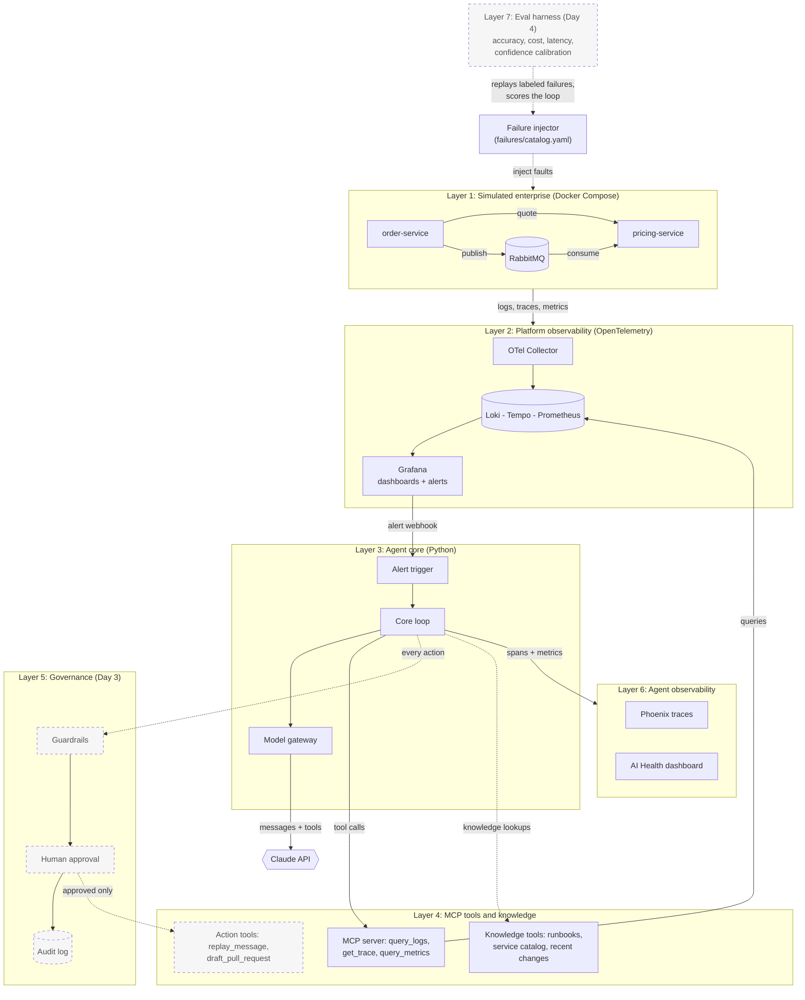
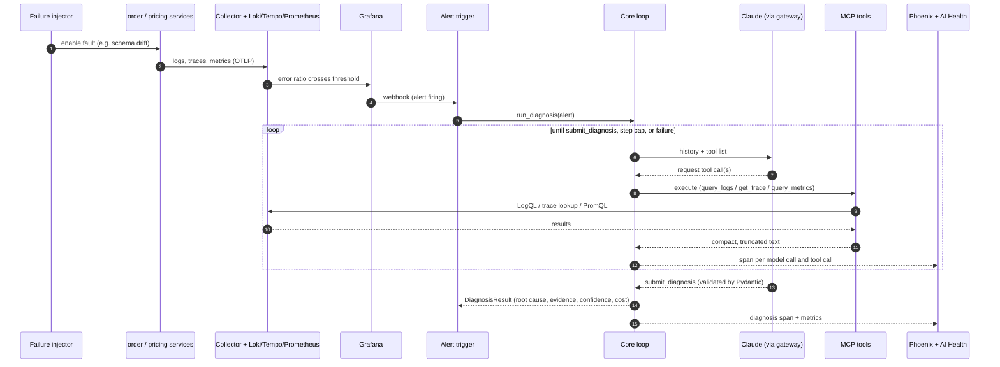
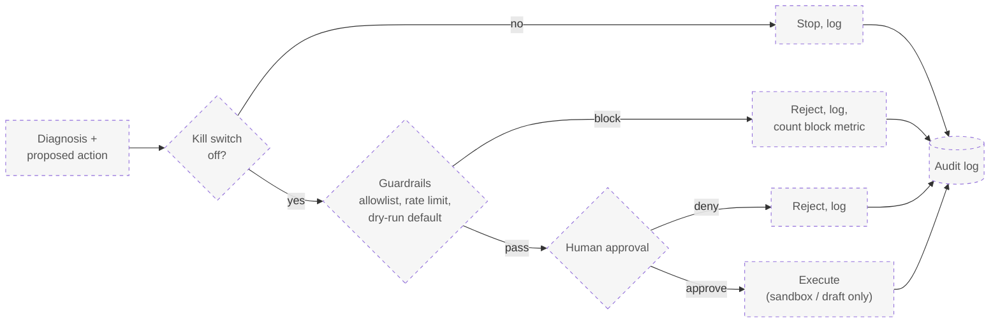

# Architecture

Two systems share one telemetry stack: a simulated order flow that breaks on purpose, and an agent that diagnoses the breakage. The same Prometheus, Grafana and Tempo that watch the orders also watch the agent.

Solid boxes are built. Dashed boxes are planned (Days 2 to 4).

## 1. System overview

## 2. From failure to diagnosis

What happens when a failure is injected, in order.

## 3. Governance control flow (Day 3, planned)

The agent can only look today. When actions arrive (`replay_message`, `draft_pull_request`), every one passes this path. Nothing executes without an approval record.

## Where things live

| Layer | Code and config |
|---|---|
| 1. Simulated enterprise | `simulator/`, `failures/catalog.yaml`, `docker-compose.yml` |
| 2. Platform observability | `observability/` |
| 3. Agent core | `agent/gateway.py`, `agent/anthropic_gateway.py`, `agent/loop.py`, `agent/trigger.py`, `agent/runner.py` |
| 4. MCP tools | `mcp_server/`, `agent/toolbox.py` |
| 4. Knowledge | `knowledge/` (content), `knowledge_store/` (lint, ingest, search), `mcp_server/knowledge_tools.py` |
| 6. Agent observability | `agent/tracing.py`, `observability/grafana/dashboards/ai-health.json` |
