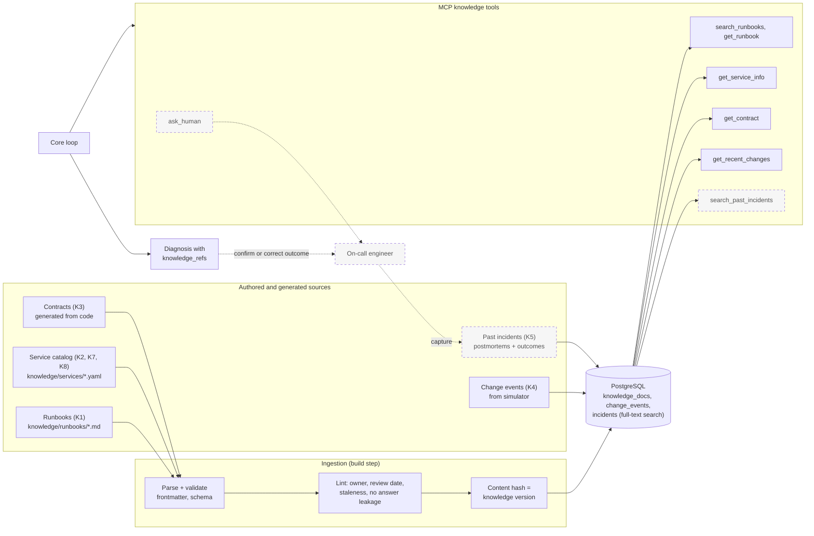

# Knowledge Layer Design

How the agent gets the system knowledge that an on-call engineer would otherwise get by asking a colleague.

| | |
|---|---|
| Status | Design. Nothing in this document is built yet. Build starts on Day 3 (see section 9). |
| Why it exists | Telemetry explains what happened. Knowledge explains why. See [solution-design.md](solution-design.md) section A1. |
| Owner of content | Ankur (runbooks, service catalog). Claude Code builds the machinery. |

## 1. Principle

The agent today has one source of truth: live telemetry (logs, traces, metrics). That covers the "look at the data" half of an investigation. The other half is knowing how the systems are wired, what changed, what has gone wrong before and how the team handles it. People carry that in their heads.

The design principle is: **turn tribal knowledge into governed, searchable, citable assets, and measure what each one is worth.**

- *Governed:* every entry has an owner, a review date and a version, and lives in the repository under review.
- *Searchable:* the agent reaches it through MCP tools, with the same limits, audit logging and tracing as every other tool.
- *Citable:* a diagnosis names the entries it relied on, and a check confirms the agent really retrieved them.
- *Measured:* evals compare the agent with and without each source, so the value of knowledge is a number, not a claim.

## 2. Knowledge sources

| ID | Source | Question it answers | Form | Tool | Phase |
|---|---|---|---|---|---|
| K1 | Runbooks | "How does the team diagnose and fix this symptom?" | Markdown with frontmatter, 15 to 20 files | `search_runbooks`, `get_runbook` | Day 3, core |
| K2 | Service catalog | "What does this service do, depend on, and promise? What are its quirks?" | One YAML file per service and queue | `get_service_info` | Day 3, core |
| K3 | Contracts | "What shape should this message or response have?" | JSON Schema for the order message, OpenAPI for each service (generated from the code) | `get_contract` | Day 3, core |
| K4 | Change events | "What changed recently?" | Rows in Postgres, fed by the simulator in the shape of real change records | `get_recent_changes` | Day 3, core |
| K5 | Past incidents | "Have we seen this before, and how did it end?" | Postgres rows, plus hand-written postmortems | `search_past_incidents` | Stretch, after the capture loop exists |
| K6 | Human answers | "What does the person who knows this system say?" | Governed question to the on-call, answer stored | `ask_human` | Stretch, reuses the approval page |
| K7 | Ownership and escalation | "Who owns this, who do I ask?" | Fields inside the K2 catalog | Part of `get_service_info`; used by K6 routing | Day 3 (data), stretch (routing) |
| K8 | SLOs and alert intent | "Why does this alert fire at 20%, and what does it mean for the business?" | Fields inside the K2 catalog and alert annotations | Part of `get_service_info` | Day 3 |
| K9 | Derived service map | "What actually calls what?" | Computed from traces in Tempo | Part of `get_service_info` (declared vs observed) | Stretch |

Telemetry (logs, traces, metrics) remains the source of live facts. The failure catalog (`failures/catalog.yaml`) is deliberately **not** a knowledge source: it holds the answers the evals score against, and exposing it would leak them.

## 3. Architecture



Why this shape:

- **Files in the repository are the source of truth** for runbooks and the catalog. They are reviewed like code, diffed, and versioned with git.
- **Postgres is the retrieval index**, not the source. Rebuilding it from the files is one command. Full-text search covers the first version, and vector search (pgvector) can be added if retrieval evals show a need.
- **The same Postgres instance** will hold the audit log, so there is one database to run and back up.
- **The knowledge version** is a hash of all ingested content. It is recorded on every trace and every audit entry, so any diagnosis can be tied to the exact knowledge it saw.

## 4. Content formats

### Runbook (K1)

```markdown
---
id: RB-007
title: Pricing consumer rejects orders with a price mismatch
kind: runbook
owner: ankur
last_reviewed: 2026-11-10
applies_to: [pricing-service, order-service]
tags: [price-mismatch, consumer-errors, quote-cache]
status: active
---

## Symptoms
What an on-call engineer sees: alert names, log phrases, metric shapes.

## Likely causes (most likely first)
1. ...

## How to confirm
What to look at, in order, and what each result means.

## Fix options
Safe actions first. Mark which need approval.

## Escalate when
Conditions that mean a person must take over.
```

Rules for authors:

- Describe **symptoms and diagnosis steps**, as a real runbook would. Do not name the failure catalog IDs or the injected fault names.
- Write from experience, in the team's voice. Specific beats general.
- Keep each runbook to one problem, under about 400 words, so a retrieved snippet is useful on its own.

### Service catalog entry (K2, K7, K8)

```yaml
id: pricing-service
kind: service
owner: ankur
last_reviewed: 2026-11-10
purpose: Serves price quotes and validates orders consumed from the orders queue.
depends_on: [rabbitmq]
depended_on_by: [order-service]
interfaces:
  http: [GET /quote/{sku}]
  consumes: [orders queue]
configuration:
  quote_cache_refresh: every 6 hours      # example fact; real values come from the author
  consumer_prefetch: 1
slo:
  consumer_error_rate: "under 20% over 1 minute (alert PricingConsumerErrorRateHigh)"
known_quirks:
  - Quotes can lag the master price list between cache refreshes.
escalation:
  ask: ankur
```

### Contract (K3)

JSON Schema for the order message and the OpenAPI document of each service are generated from the Pydantic models and FastAPI apps already in the code, so they cannot drift from reality. `get_contract` returns the relevant excerpt.

### Change event (K4)

```json
{
  "ts": "2026-11-10T09:12:00Z",
  "service": "pricing-service",
  "kind": "config",
  "summary": "quote cache refresh interval changed from 15m to 6h",
  "actor": "release-pipeline",
  "ref": "CHG-2041"
}
```

## 5. Data model

| Table | Key fields | Used by |
|---|---|---|
| `knowledge_docs` | id, kind (runbook, service, contract), title, body, owner, last_reviewed, applies_to[], tags[], status, source_path, content_hash, search vector | K1, K2, K3 tools |
| `change_events` | id, ts, service, kind, summary, actor, ref | K4 tool |
| `incidents` | id, ts, alert, diagnosis (json), outcome (confirmed, corrected, unknown), corrected_root_cause, reviewer, knowledge_version | K5, evals |
| `knowledge_versions` | version hash, ingested_at, doc count | Audit log, traces |
| `knowledge_lookups` | ts, diagnosis id, tool, query, returned ids, knowledge_version | Governance (every lookup is audit-logged) |

## 6. Tool contracts

All knowledge tools follow the Day 2 rules: validated inputs, compact size-capped output, errors returned as readable results, and every call traced and (from Day 3) audit-logged.

| Tool | Inputs | Returns |
|---|---|---|
| `search_runbooks` | query, service (optional), limit (1 to 5) | Ranked list: id, title, a snippet of at most 500 characters, owner, last_reviewed |
| `get_runbook` | id | Full text, capped, with owner and review date |
| `get_service_info` | service | Catalog entry rendered as text, including owner and escalation |
| `get_contract` | name (queue message or endpoint) | Schema excerpt |
| `get_recent_changes` | service (optional), minutes (up to 1440), limit | Change events newest first |
| `search_past_incidents` | query, limit | Earlier diagnoses with outcome, labeled lower trust |
| `ask_human` | question, context | Pauses the diagnosis until answered; question and answer audit-logged |

Every result carries the entry id so the agent can cite it.

### Diagnosis schema change

`Diagnosis` gains an optional list `knowledge_refs` (entry ids, for example `RB-007`, `svc:pricing-service`, `CHG-2041`). The loop can then verify that every cited id was returned by a tool call in the same run, the same way evidence quotes are checked today.

## 7. Governing the knowledge

Knowledge steers the agent, so it needs controls of its own.

| Risk | Control |
|---|---|
| Stale runbook gives a confident wrong answer | Owner and `last_reviewed` on every entry. Lint fails the build for entries older than a set age. The tool output shows the review date to the model. |
| Wrong or unreviewed content | Changes go through pull request review. Ankur reviews content like code. |
| Agent cites something it never read | Citation check against the run's retrieved ids. |
| Poisoned knowledge (including agent-written incident records) | Trust levels: authored and reviewed content is high trust; incident records derived from agent output are labeled lower trust. Knowledge text is still treated as data, never as instructions. |
| Answer leakage into evals | Lint rejects runbooks that name catalog IDs or injected fault names. The failure catalog is never ingested. |
| Silent change in behavior after a content edit | The knowledge version hash is on every trace and audit entry, and evals record it. |
| Sensitive content | Entries describe a simulated system. The same discipline applies in a real deployment: no secrets or customer data in knowledge files. |

## 8. Changes to the simulator

Two changes make the knowledge sources realistic and keep the evals honest.

1. **Remove the answer leak.** The fault registry logs `fault enabled name=...` and `fault cleared`. The agent can read those in Loki and diagnose trivially. Those log lines are removed from the services.
2. **Emit realistic change events instead.** When the injector enables a fault, it writes a change event worded like a real change record (a config change, a deploy, a schema version bump), not the fault's internal name. Each failure in the catalog gets a `change_event` field. Alongside it the injector emits unrelated **distractor** events, so the agent must pick the relevant change out of noise as a person would.

A change feed makes some diagnoses easier. That is realistic, and the ablation (section 10) measures exactly how much easier.

## 9. Revised build plan

The knowledge layer adds real work. Day 3 as originally written (knowledge, actions, governance, cost, kill switch, adversarial tests, agent alerts) was too much for one day, so the plan becomes five days. The telemetry-only baseline runs **before** knowledge exists, which turns Day 2's end-to-end run into the first arm of the ablation.

| Day | Theme | Work | Done when |
|---|---|---|---|
| 1 | Platform and telemetry | Built | Injected failures fire alerts (done) |
| 2 | Agent core | Gateway, MCP telemetry tools, schema, trigger, tracing, dashboard (built). Ankur writes the loop. End-to-end run. **Baseline arm A: telemetry only.** | An alert produces a diagnosis in Phoenix and Grafana; arm A scored informally |
| 3 | Knowledge layer | Postgres, ingestion, lint, versioning; K1 to K4 tools; `knowledge_refs` and citation check; simulator change events and leak removal; retrieval tests. Ankur writes runbooks and catalog entries (can start now, in parallel). | Agent cites a runbook and a catalog entry in a diagnosis; retrieval tests pass |
| 4 | Actions and governance | `replay_message` (sandbox), `draft_pull_request` (draft), approval page, audit log (including knowledge lookups), guardrails, kill switch, cost tracker, adversarial tests, alert rules on the agent. Stretch: K5 past incidents, K6 `ask_human`. | A proposed fix waits for approval; only approved actions execute; the kill switch stops new diagnoses |
| 5 | Evals and publish | Eval harness and scorer, ablation arms B to D, calibration, tuning and rerun, README with control mapping, demo, publish | Before-and-after numbers and the ablation chart captured; repo and post published |

If the schedule must stay at four days, the cut order is: LangGraph port (already optional), then K5 and K6, then K9, then the second ablation arms. Never cut evals, the approval gate or the knowledge citation check.

### Who does what

| Task | Owner |
|---|---|
| Core loop | Ankur |
| 15 to 20 runbooks and the service catalog entries | Ankur (can start before Day 3) |
| Real failure catalog | Ankur |
| Ingestion, lint, store, tools, schema change, simulator changes, tests | Claude Code |
| Action tools and guardrails | Claude Code scaffolds, Ankur reviews every line |

### Authoring plan for Ankur

The runbook set is designed so the evals can tell whether knowledge helps, not just whether the agent was handed the answer.

| Group | Count | Purpose |
|---|---|---|
| Runbooks that match catalog failures | about 10 | Test whether the agent finds and uses the right knowledge |
| Failures deliberately **without** a runbook | 2 to 3 | Test the no-knowledge case; the agent must reason from telemetry |
| Distractor runbooks for unrelated problems | about 5 | Test retrieval precision; the agent must ignore what does not fit |
| Service catalog entries | order-service, pricing-service, RabbitMQ and the alert rules | Context for every diagnosis |

## 10. Evaluating the knowledge layer

| Check | How | What it tells us |
|---|---|---|
| Retrieval quality | Golden queries paired with the expected entry; recall at 3 | Whether search finds the right entry before the agent is involved |
| Ablation | Same failures, four arms: **A** telemetry only; **B** plus runbooks; **C** plus catalog, contracts and change events; **D** plus past incidents and `ask_human` | What each source is worth in accuracy, cost and latency |
| Citation precision | Share of cited ids that were retrieved and relevant | Whether the agent grounds claims in real entries |
| Missing-knowledge behavior | Failures without a runbook | Whether the agent admits low confidence instead of forcing a match |
| Stale-knowledge test | One deliberately outdated runbook | Whether the agent over-trusts it, and whether the review date helps |
| Leakage check | Search the knowledge and the logs for catalog IDs and fault names | That accuracy is earned |

The headline result for the write-up is the ablation: how much accuracy, and at what cost, did tribal knowledge add.

## 11. Open questions

- **Retrieval method.** Full-text search first. Move to pgvector only if recall at 3 is poor.
- **Where change events live in the real world.** The simulator invents them. In production they come from a deploy pipeline or change-management system. The tool contract stays the same.
- **Past incident trust.** How much weight agent-written records deserve until a human confirms them.
- **Knowledge size.** At 15 to 20 runbooks the agent could be given more of it directly. The design assumes a larger corpus, and the ablation will show whether search is even needed at this scale.
