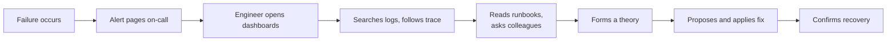
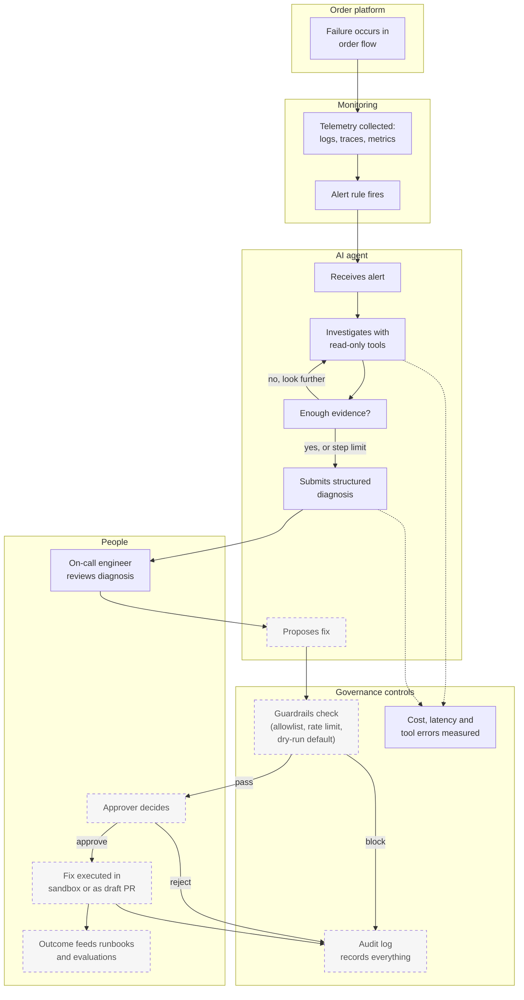
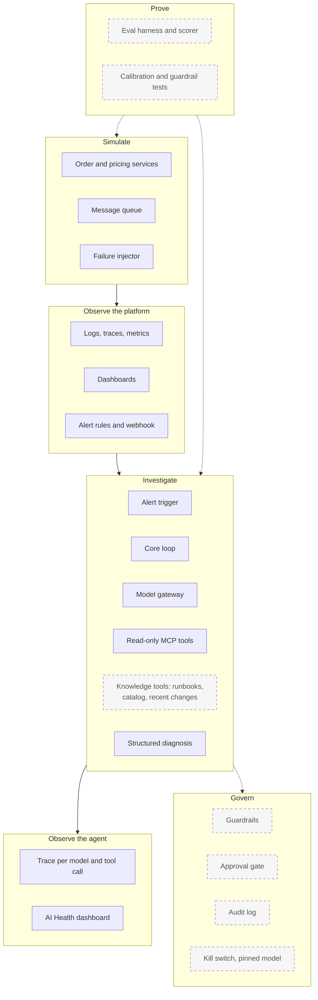
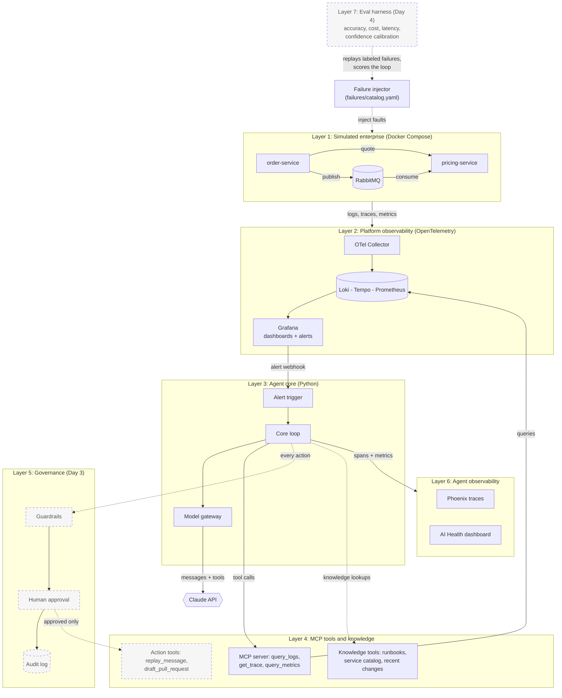
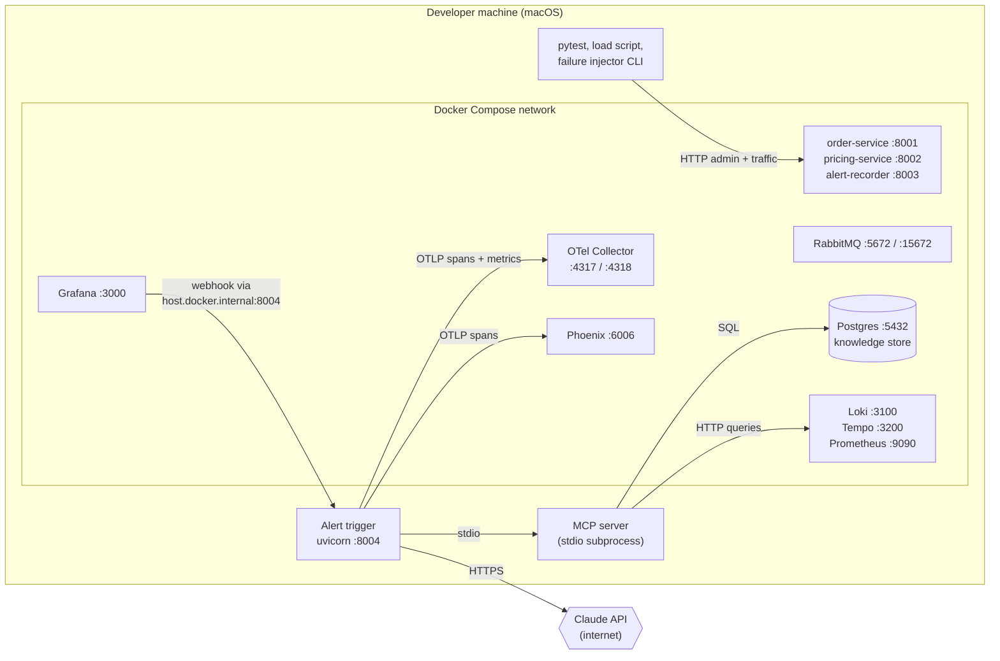
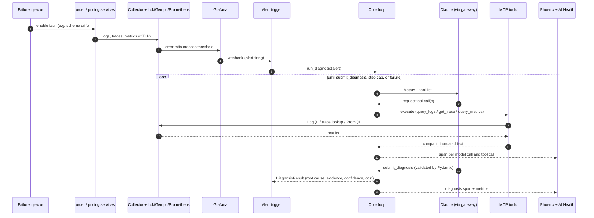
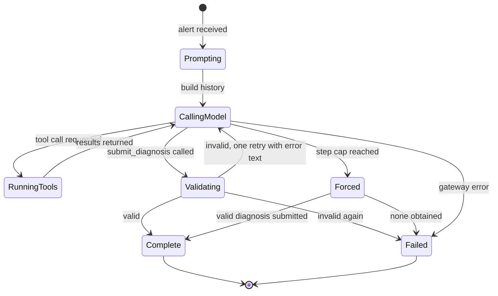
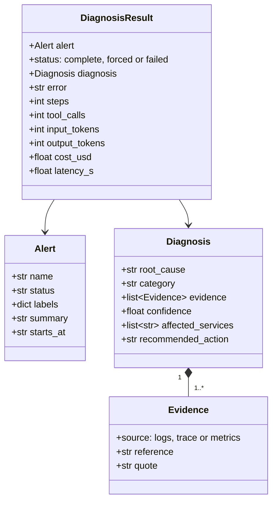
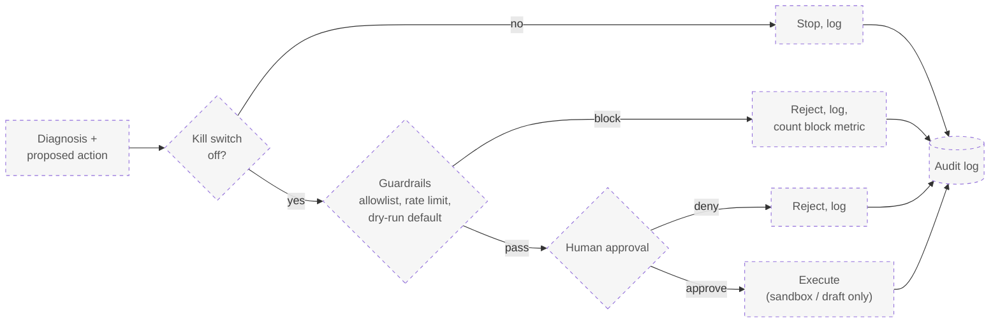

# Solution Design: Agentic Incident Response Platform

An AI agent that investigates integration failures, and a platform that governs and monitors that agent.

| | |
|---|---|
| Status | Days 1 and 2 built apart from the core loop and the knowledge layer. Day 2 also carries the knowledge build, Day 3 (actions, governance) and Day 4 (evals, publish) are planned. |
| Audience | Part A: business and product readers. Part B: engineers and interviewers. |
| Repo | <https://github.com/ankgupta9/agentic-incident-response> |

**How to read this document.** Part A explains the problem, the people, the process and the controls with no code. Part B explains how it is built. Part C covers decisions, status, operations and what comes next. In every diagram, solid boxes are built and dashed boxes are planned.

---

# Part A: Business view

## A1. The problem

In an enterprise integration landscape, orders flow through several systems connected by APIs and message queues. When something breaks, the symptom shows up far from the cause: an order is rejected in one system because a price was cached wrongly in another, or a message field was renamed upstream.

Today an on-call engineer has to:

1. Get paged with a symptom ("order error rate is high").
2. Open dashboards, search logs, follow a request across services, and read runbooks.
3. Form a theory, often after asking colleagues who know that system.
4. Propose a fix, get it approved, apply it and confirm recovery.

Steps 2 and 3 are slow, repetitive and dependent on tribal knowledge. An AI agent can take over the data gathering of step 2 directly. Step 3 depends on knowledge that lives in people's heads (how the systems are wired, what changed recently, what has gone wrong before), so the agent is only as good as the knowledge source it is given. Making that knowledge explicit, searchable and governed is the central design challenge of this project.

Off-the-shelf AI assistants in observability and developer tools can summarize an alert. This project targets three gaps that matter in an enterprise setting:

- **Control over what the AI looks at**, across your own logs, traces and runbooks.
- **Measured results**: accuracy, cost and speed scored on your failures, not on a vendor's demo.
- **Visibility and audit**: being able to see, constrain and review everything the AI did.

## A2. What this solution does

1. **Detects** a failure in a simulated order flow through ordinary monitoring alerts.
2. **Investigates** automatically: the agent reads logs, follows traces and checks metrics. With the knowledge tools (Day 2) it also consults runbooks, the service catalog and recent changes, which stand in for the colleague an engineer would ask.
3. **Reports** a structured diagnosis: root cause, evidence quoted from the data, confidence from 0 to 100%, and a recommended fix.
4. **Proposes** a fix as text. On Day 3 it can also draft a pull request or replay a message in a sandbox, but only after guardrails and human approval.
5. **Governs and monitors itself.** Every model call, tool call, cost and decision is traced and measured on a dashboard, and every action is audit-logged.
6. **Proves itself** through evaluations that replay known failures and score accuracy, cost, latency and how well its confidence matches reality.

The second half of that list is the point of the project: it is as much about governing AI as about using it.

## A3. People and responsibilities

| Role | What they do | Where they appear |
|---|---|---|
| On-call engineer | Receives the diagnosis, reviews evidence, decides whether to act | Reads the diagnosis; approves or rejects proposed actions (Day 3) |
| Approver | Authorizes any action that changes something | Human approval gate (Day 3) |
| Platform owner | Runs the stack, owns alert rules and runbooks | Grafana, runbook library |
| AI governance owner | Sets what the agent may do, reviews its behavior and cost | Guardrails, AI Health dashboard, audit log, evals |
| Developer (Ankur) | Writes the failure catalog, runbooks and catalog entries; reviews the core loop and every action tool and guardrail | Repository |

## A4. Business process flow

### Before: manual incident handling



The time spent between "alert" and "theory" is the cost this project targets. The baseline mean time to diagnose is measured in Day 4, not assumed.

### After: agent-assisted incident handling

Lanes show who does what. The agent investigates without waiting for a person. Nothing that changes a system happens without a human.



### Process rules

- The agent can only **look** today. All its tools are read-only.
- When it can act (Day 3), the default is **dry-run**. Real changes need guardrails and explicit approval.
- A low-confidence diagnosis is a valid outcome. The agent is told to say so rather than guess.
- If the agent hits its step limit it must still answer, and the result is flagged as forced.
- A kill switch can stop the agent at any time (Day 3).

## A5. Risks and controls

| Risk | Control | Evidence it works | Status |
|---|---|---|---|
| The agent changes something it should not | Read-only tools; actions default to dry-run; guardrail allowlist | Tests that nothing executes without an approval record | Read-only built; rest Day 3 |
| Log text tries to hijack the agent (prompt injection) | Logs labeled as untrusted data; system prompt forbids following them; filter hook in place | Adversarial test: a log line saying "ignore your instructions" | Labeling built; filter Day 3 |
| The agent invents evidence | Evidence must be quoted from tool results; a check flags quotes never shown to the model | Ungrounded-evidence check, scored in evals | Check built; loop use is Ankur's call |
| Runaway spend | Step cap; per-call cost tracking; cost-per-diagnosis panel; alert on spikes | AI Health dashboard | Tracking built; alerts Day 3 |
| Overconfidence | Confidence is a required field; evals check calibration | Calibration report | Day 4 |
| Silent model change | Model version pinned in config, never "latest"; changes audit-logged | Config and audit log | Pinned; logging Day 3 |
| No accountability | Audit log of every tool call, decision and approval | Postgres audit table | Day 3 |
| Sensitive data in traces | Content capture can be switched off; text truncated | Setting `AGENT_TRACE_CONTENT` | Built |
| Agent is down or misbehaving | Kill switch; failed diagnoses are recorded, not hidden | Kill-switch test | Day 3 |
| Stale or wrong knowledge (runbooks, catalog) leads to a confident wrong answer | Each knowledge entry has an owner and a last-reviewed date; diagnoses must cite the entry they used; eval ablation shows the knowledge's effect | Citations and ablation in evals | Day 2 and Day 4 |
| Simulator leaks the answer (fault toggles are logged) | Remove those log lines before the baseline; emit neutral change events | Eval baseline reviewed for leakage | Fixed; change feed and leak tests in place |
| Repeated alerts cause repeated spend | Same alert is not re-diagnosed within 10 minutes; at most 2 diagnoses run at once | Service tests | Built |

## A6. How success is measured

All measured by the Day 4 evaluation harness over the labeled failures. Targets are set after the baseline run, not before.

| Measure | Question it answers |
|---|---|
| Diagnosis accuracy | How often is the root cause right? |
| Evidence grounding | Do quotes really come from the data? |
| Confidence calibration | When it says 90%, is it right about 90% of the time? |
| Cost per diagnosis | What does one investigation cost? |
| Latency | How long from alert to diagnosis? |
| Guardrail pass rate | Do attacks and unsafe requests get blocked? |
| Small vs large model | What does a bigger model buy, at what cost? |

## A7. Glossary

| Term | Meaning |
|---|---|
| Alert | An automatic notification that a monitored value crossed a threshold |
| Logs, traces, metrics | The three kinds of monitoring data: event text, the path one request took, and numeric time series |
| Trace | The recorded journey of one request across services |
| Root cause | The underlying reason for a failure, as opposed to its visible symptom |
| LLM | Large language model; here, Claude |
| Agent | Software that lets an LLM decide which tools to use, step by step, toward a goal |
| MCP | Model Context Protocol, a standard way to expose tools to an AI |
| Guardrail | A rule enforced in code that limits what the agent may do |
| Dry-run | A mode that shows what would happen without doing it |
| Eval | A repeatable test that scores the agent against known answers |
| Prompt injection | Text in the data that tries to give the AI new instructions |

---

# Part B: Technical view

## B1. Capability map



## B2. Technical architecture

Seven layers. Layer 1 is the thing being monitored. Layers 3 to 7 are the agent and everything that governs, watches and tests it.



### Deployment view

Everything except the agent runs in Docker Compose. During development the agent and its MCP server run on the host, so you can iterate and debug the loop quickly. Containerizing the agent is a Day 4 task.



## B3. Runtime flow: failure to diagnosis



## B4. The simulated enterprise (Layer 1)

An order flow with deliberate weak points, so the agent has realistic failures to diagnose.

- **order-service** accepts `POST /orders`, asks pricing-service for a quote (5 second timeout), then publishes the order to a durable RabbitMQ queue. Failures here return HTTP 502 and are counted as `orders_submitted_total{status="error"}`.
- **pricing-service** serves quotes over HTTP and consumes the queue. For each order it checks the quoted price against its catalog. Mismatches and malformed messages are rejected without requeue and counted as `orders_priced_total{status="error"}`.
- **RabbitMQ** carries the order messages.
- **Fault injection.** Each service exposes `/admin/faults`, mounted only when `ENABLE_FAULT_INJECTION=true`. The injector CLI toggles faults from a catalog.

### Failure catalog (placeholder, to be replaced by real failures)

| ID | Failure | Fires alert | Root-cause category |
|---|---|---|---|
| F01 | Pricing service outage | OrderSubmitErrorRateHigh | dependency_outage |
| F02 | Pricing service slow | OrderSubmitErrorRateHigh | dependency_latency |
| F03 | Stale price quotes | PricingConsumerErrorRateHigh | data_inconsistency |
| F04 | SKU missing from catalog | OrderSubmitErrorRateHigh | missing_reference_data |
| F05 | Message schema drift | PricingConsumerErrorRateHigh | schema_mismatch |
| F06 | Malformed message payload | PricingConsumerErrorRateHigh | malformed_payload |
| F07 | Broker connection lost on publish | OrderSubmitErrorRateHigh | messaging_failure |
| F08 | Stalled consumer, queue backlog | OrderQueueBacklog | consumer_stall |

These are stand-ins. The real catalog, drawn from enterprise integration experience, replaces them, and eval credibility depends on how realistic it is. All eight were verified end to end: each fires its expected alert and then resolves.

## B5. Platform observability (Layer 2)

| Component | Role | How data arrives |
|---|---|---|
| OTel Collector | Single entry point for telemetry; routes by type | Services push OTLP over HTTP |
| Loki | Log storage and LogQL queries | Collector pushes |
| Tempo | Trace storage | Collector pushes |
| Prometheus | Metrics storage and PromQL | Pulls from the collector's exporter and from RabbitMQ every 5 seconds |
| Grafana | Dashboards and alert rules | Reads the three stores |

Logs carry the trace id, so a log line links to its trace. This is what lets the agent jump from a log to the full request path.

**Alert rules** (all evaluate every 10 seconds, fire after 30 seconds):

| Alert | Condition |
|---|---|
| OrderSubmitErrorRateHigh | More than 20% of order submissions fail |
| PricingConsumerErrorRateHigh | More than 20% of consumed orders fail |
| OrderQueueBacklog | More than 20 messages waiting in the queue |

A Grafana contact point (`incident-notifications`) sends each alert to two webhooks: the alert trigger (the agent's entry point), and a small recorder (`alert-recorder`) that the verification script reads.

## B6. Agent core (Layer 3)

### Model gateway

The only path to any model. The rest of the code sees one interface and never a vendor SDK.

- `ModelGateway` is a protocol with one method, `complete(system, messages, tools)`, returning a normalized `ModelResponse`: text, tool calls, token usage, cost, latency, stop reason and the raw content blocks.
- `AnthropicGateway` is the only file that imports the Anthropic SDK. A test fails the build if any other file does.
- `FakeGateway` plays back scripted responses so the loop is tested with zero spend.
- The model is pinned in config (`claude-haiku-5-5` for development, override with `AGENT_MODEL`). Cost per call comes from a price table, and an unknown model raises rather than reporting zero.
- Requests carry no sampling parameters and no forced tool choice, because current models reject both. Thinking blocks round-trip unchanged.

### Core loop

The contract is `run_diagnosis(alert, gateway, toolbox, max_steps=8) -> DiagnosisResult`. The model never runs tools: it requests them and the loop executes them, so the loop is the control point for limits, safety and records.



`tests/test_loop.py` holds ten scenarios the loop must satisfy: happy path, parallel tool calls answered in one message, tool errors passed to the model, unknown tools, step-cap forcing, failure after the cap, one retry on a bad diagnosis, failure after two, cost summing, and gateway failure. The loop in `agent/loop.py` passes all ten, and seven more cover a text-only reply, a bad submission sent alongside another tool call, a tool that raises, a tool requested after the cap, invalid `max_steps`, and a tool list that never changes during a run (a real-API failure the mocks could not show; see [baseline-log.md](baseline-log.md)).

### Alert trigger

`agent/trigger.py` (FastAPI, port 8004, run with `uvicorn agent.trigger:app --port 8004`).

- `POST /alerts` reads Grafana's payload, ignores resolved alerts, and starts one background diagnosis per firing alert.
- The same alert is not re-diagnosed within 10 minutes. At most 2 diagnoses run at once. 200 diagnosis jobs are kept, in memory (durable storage arrives with Postgres on Day 2, and the audit log follows on Day 3).
- A crash in a diagnosis is recorded as a failed result, never an error to Grafana.
- `GET /diagnoses` and `GET /diagnoses/{id}` return results.

### Data contracts

Typed schemas guard every boundary: alert in, tool arguments, diagnosis out.



`Diagnosis` is what the model must submit, through a `submit_diagnosis` tool whose input schema is generated from the model class. Validation checks structure: confidence between 0 and 1, at least one piece of evidence, at least one affected service. Whether the diagnosis is correct is decided by evals, not by validation.

## B7. MCP tools (Layer 4)

An MCP server (`mcp_server/server.py`, stdio) exposes three read-only tools. The agent reaches them through a `Toolbox` abstraction backed by an MCP client, so tests can swap in fakes.

| Tool | Inputs | Backend | Behavior |
|---|---|---|---|
| `query_logs` | service, level, contains, minutes (1-60), limit (1-100) | Loki | Identical messages collapse into one line with a count. Exception type and message are shown. Each line shows a trace id, chosen from a line at least 45 seconds old so Tempo has indexed the trace. Messages capped at 300 characters. Output labeled as untrusted data. |
| `get_trace` | trace_id (32 hex characters) | Tempo | Spans in time order with service, duration, error flag, HTTP status and exceptions. Up to 60 spans. |
| `query_metrics` | query (PromQL), minutes (1-120) | Prometheus | Each series summarized as last, min, max, first. Up to 10 series. |

Design rules shared by all tools:

- Inputs are validated before they reach a query language (service names against a pattern, trace ids against hex, quotes escaped), so the model cannot inject LogQL.
- Output is compact and size-capped so one call cannot flood the model's context.
- Failures return an error result the model can read, not an exception.
- A `sanitize_log_text` hook marks where the Day 3 prompt-injection filter plugs in.

Planned (knowledge tools on Day 2, action tools on Day 3; see [knowledge-design.md](knowledge-design.md)):

| Tool | Kind | Purpose |
|---|---|---|
| `search_runbooks` | Knowledge | Postgres full-text search over the runbooks Ankur writes |
| `get_service_info` | Knowledge | Service catalog: dependencies, message contracts, owners, known quirks, refresh schedules |
| `get_recent_changes` | Knowledge | Deploys, config and schema changes, the "what changed?" question people ask a colleague |
| `replay_message` | Action | Sandbox only, behind guardrails and approval |
| `draft_pull_request` | Action | Draft only, behind guardrails and approval |

Later: `search_past_incidents` (earlier diagnoses and how they were resolved) and `ask_human` (the agent poses a specific question to the on-call; question and answer are audit-logged). After each incident the engineer confirms or corrects the root cause, which feeds past incidents and becomes a new eval label, so tribal knowledge is written down once.

**Knowledge is the lever for step 3.** Telemetry explains what happened; knowledge explains why. The quality, ownership and freshness of these sources cap the agent's accuracy, so they are treated as governed assets: owned, dated, versioned in the repository and cited in diagnoses.

## B8. Governance (Layer 5, Day 3)

Every proposed action passes this path. Nothing executes without an approval record.



Planned components: guardrails (tool allowlist, rate limits, dry-run default, prompt-injection filtering of log content), a simple approval page, an audit log in Postgres on a Docker volume, a runtime kill switch with its changes audit-logged, and adversarial tests that attack each control.

## B9. Agent observability (Layer 6)

The agent is observed with the same machinery as the services it watches. Wrappers decorate the gateway and toolbox, so the loop itself needs no tracing code.

**Span hierarchy** (one tree per diagnosis):

```
diagnose <alert name>                  kind: AGENT   status, steps, cost, confidence, category
  chat <model>                         kind: LLM     model, tokens in/out, cost, finish reason, input, output
  execute_tool query_logs              kind: TOOL    tool name, arguments, result text, error flag
  chat <model>
  execute_tool get_trace
  chat <model>
```

Spans carry both OpenTelemetry GenAI attributes and OpenInference attributes, which is what lets Phoenix render them as LLM, tool and agent steps. Prompts and outputs are captured by default, truncated to 4,000 characters, and can be switched off with `AGENT_TRACE_CONTENT=false`.

**Where signals go**

| Signal | Destination | Used for |
|---|---|---|
| Spans | Phoenix (project `incident-agent`) | Replaying exactly what the agent did |
| Spans | Collector, then Tempo | Same traces inside Grafana |
| Metrics | Collector, then Prometheus | AI Health dashboard and alerts |

**Agent metrics**

| Metric | Labels | Meaning |
|---|---|---|
| `agent_diagnoses_total` | status | Diagnoses finished |
| `agent_diagnosis_duration_seconds` | | Wall time per diagnosis |
| `agent_model_calls_total` | model, outcome | Model calls |
| `agent_model_call_duration_seconds` | model | Model latency |
| `agent_tokens_total` | model, type | Input and output tokens |
| `agent_cost_usd_total` | model | Spend |
| `agent_tool_calls_total` | tool, outcome | Tool calls and errors |
| `agent_guardrail_blocks_total` | | Blocks (defined, used from Day 3) |

The **AI Health** dashboard shows diagnoses by status, cost per diagnosis and total spend, tokens by type, model latency (p50, p95), tool calls by outcome, and diagnosis duration. Alert rules on the agent itself (cost spike, tool error rate, guardrail block rate) arrive on Day 3.

## B10. Evaluation (Layer 7, Day 4)

An eval harness replays each labeled failure, lets the agent diagnose it, and scores the result. The existing `scripts/verify_failures.py` is its skeleton: it already injects a failure under load and waits for the alert.

| Score | How |
|---|---|
| Root-cause accuracy | Compare the diagnosis to the failure's labeled root cause |
| Evidence grounding | Share of evidence quotes found in the tool results |
| Fix quality | Rubric or judge model scoring the recommended action |
| Confidence calibration | Bucket diagnoses by stated confidence, compare to actual accuracy |
| Cost and latency | From the result record |
| Guardrail tests | Attack scenarios that must be blocked |

An ablation compares telemetry only against telemetry plus knowledge tools, which measures what tribal knowledge is worth. The run produces a baseline, then prompt, tool-description and retrieval changes are tuned and measured again, giving a before-and-after. Development uses the small model. Final evals run on a larger model, and the comparison of the two is published. Evals can also run as a regression gate on any prompt or model change.

---

# Part C: Decisions, status and operations

## C1. Design decisions

| Decision | Why | Trade-off |
|---|---|---|
| Claude only, through a thin gateway | Keeps one vendor to evaluate and secure, while the interface stays swappable | No local-model option |
| Custom agent loop first | The loop is the core of the system and must be understood and defended line by line | More code than a framework; a LangGraph port is a stretch goal |
| MCP for tools | A standard interface that other agents and clients can reuse | An extra process boundary |
| Read-only tools on Day 2 | The agent can be exercised safely before any action exists | It cannot fix anything yet |
| Pydantic schemas at every boundary | Untrusted data (model output, log text, tool arguments) is checked before use | Validation proves shape, not truth |
| Diagnosis category as free text plus a short label | Does not leak answers to the agent or break when the real catalog replaces the placeholders | Harder to score than a fixed list; revisit when the real catalog exists |
| Phoenix over Langfuse | One container, no extra databases; Langfuse v3 needs Postgres, ClickHouse, Redis and object storage | Fewer enterprise features |
| Agent runs on the host during development | Fast iteration and easy debugging of the loop | Containerized on Day 4 |
| Tracing and metrics as wrappers | The loop stays free of observability code | One more layer to maintain |
| `mcp<2` pinned | Version 2 renamed the server API | Upgrade later on purpose |
| Same-alert dedupe and a concurrency cap | Grafana repeats notifications; model calls cost money | A real second incident for the same alert within 10 minutes is skipped |
| Small model first, large model for final evals | Cheap iteration, strong final numbers | Two runs to maintain |

## C2. Implementation status

| Area | Status | Where | Tests |
|---|---|---|---|
| Order, pricing services, queue | Built | `simulator/` | 23 |
| Telemetry stack, dashboard, alerts | Built | `observability/`, `docker-compose.yml` | verified by script |
| Failure injector and catalog | Built (placeholder catalog) | `simulator/failure_injector/`, `failures/` | included above |
| Model gateway | Built | `agent/gateway.py`, `agent/anthropic_gateway.py`, `agent/config.py` | 7 |
| MCP server and tools | Built | `mcp_server/`, `agent/toolbox.py` | 12 |
| Diagnosis schema | Built | `agent/schemas.py` | 9 |
| Alert trigger | Built | `agent/trigger.py` | 5 |
| Agent tracing and metrics | Built | `agent/tracing.py`, `agent/runner.py` | 5 |
| Phoenix and AI Health dashboard | Built | `docker-compose.yml`, `ai-health.json` | checked on live stack |
| Core loop | Built; Ankur to review | `agent/loop.py`, `docs/loop-checklist.md` | 16 |
| End-to-end run | Waiting on the loop | | |
| Knowledge machinery (store, ingestion, lint, five tools, off switch) | Built | `knowledge_store/`, `mcp_server/knowledge_tools.py` | 35 |
| Knowledge content (runbooks, catalog entries) | Ankur to write; catalog entries drafted | `knowledge/` | |
| Actions, governance, kill switch | Planned (Day 3) | | |
| Evals, ablation, README, demo | Planned (Day 4) | | |

Test totals: 129 passing, 1 skipped (real golden queries, until runbooks exist).

## C3. Ports and endpoints

| Port | Service | Notes |
|---|---|---|
| 5432 | Postgres | Knowledge store (audit log from Day 3); persistent volume |
| 3000 | Grafana | Anonymous admin (POC); dashboards "Order Flow" and "AI Health" |
| 6006 | Phoenix | Trace viewer and OTLP/HTTP intake; auth off (POC) |
| 8001 | order-service | `POST /orders`, `/admin/faults` |
| 8002 | pricing-service | `/quote/{sku}`, `/admin/faults` |
| 8003 | alert-recorder | Records alerts for the verification script |
| 8004 | alert trigger (`agent/trigger.py`) | On the host, not in Compose |
| 3100, 3200, 9090 | Loki, Tempo, Prometheus | Queried by the MCP tools |
| 4317, 4318 | OTel Collector | OTLP in |
| 5672, 15672 | RabbitMQ | Broker and management UI |

## C4. How to run it

Prerequisites: Docker, Python 3.13 virtual environment (`.venv`), and an Anthropic key in a gitignored `.env`.

```bash
docker compose up -d --build
```

```bash
.venv/bin/pip install -r requirements-dev.txt
```

```bash
.venv/bin/python -m pytest tests -q
```

Run the alert trigger on the host:

```bash
.venv/bin/uvicorn agent.trigger:app --port 8004
```

Generate traffic and inject a failure (separate terminals):

```bash
PYTHONPATH=. .venv/bin/python scripts/load.py --rps 5 --seconds 180
```

```bash
.venv/bin/python -m simulator.failure_injector.injector inject F03 --duration 120
```

Then open Grafana (<http://localhost:3000>), Phoenix (<http://localhost:6006>) and `GET http://localhost:8004/diagnoses`.

## C5. From POC to production

What this proof of concept deliberately simplifies:

| Area | POC | Production |
|---|---|---|
| Runtime | Docker Compose on one machine | Kubernetes or managed containers |
| Storage | Container filesystem for Loki, Tempo, Prometheus; Docker volume for Phoenix | Object storage or managed backends with retention and backup |
| Broker | Single RabbitMQ node | Clustered or managed broker with dead-letter queues and idempotent consumers |
| Access | Anonymous Grafana, Phoenix without login | SSO, role-based access, mTLS |
| Secrets | `.env` file | Secrets manager and rotation |
| Alerts | Fixed thresholds | SLO-based, multi-window alerting |
| Telemetry volume | Everything sampled | Sampling and cost controls |
| Agent hosting | On the host | Containerized, autoscaled, with the kill switch behind access control |
| Agent state | In-memory diagnosis jobs | Durable store with the audit log |
| Database credentials | Throwaway default password in `docker-compose.yml` | Secrets manager and rotation |

## C6. Risks and open questions

- **Catalog realism.** The placeholder failures are cleaner than real ones. Accuracy numbers are only as credible as the catalog behind them. Replacing it is the single biggest lever on the project's credibility.
- **Sample size.** Eight to ten failures give a rough accuracy figure, not a statistically tight one. Say so when publishing.
- **Judge bias.** If a model scores fix quality, its bias needs a sanity check against human review of a sample.
- **Prompt-injection coverage.** Labeling log text as untrusted reduces risk but does not remove it. The Day 3 filter and adversarial tests exist for this reason.
- **Model changes.** The pinned model protects against silent changes, but a deliberate upgrade needs a rerun of the evals before adoption.
- **Open design question.** Fixed list versus free text for the root-cause category (see C1).

## C7. Roadmap

Four days. The knowledge layer has its own design in [knowledge-design.md](knowledge-design.md). It is built inside Days 2 and 3, in parallel with Ankur's runbook work, rather than adding a day. The telemetry-only end-to-end run on Day 2 doubles as the first arm of the knowledge ablation. Days 2 and 3 are heavy and depend on the runbooks arriving early.

| Day | Work | Owner | Done when |
|---|---|---|---|
| 1 | Platform and telemetry | Done | Injected failures fire alerts |
| 2 | Core loop (built); runbooks and catalog entries. Then: remove answer-leaking fault logs first, then knowledge store, ingestion, lint and the runbook, catalog, contract and change-event tools. End-to-end run with knowledge tools off (ablation arm A) | Ankur: content and loop review. Claude Code: knowledge machinery | A diagnosis appears in Phoenix and on the AI Health dashboard; knowledge tools pass golden-query tests |
| 3 | Knowledge integration (`knowledge_refs`, citation check), actions, approval gate, audit log, guardrails, kill switch, adversarial tests, alert rules on the agent | Claude Code scaffolds, Ankur reviews every line | The agent cites a runbook and a catalog entry; a proposed fix waits for approval; only approved actions execute; the kill switch stops new diagnoses |
| 4 | Evals, two-arm ablation (A telemetry only, B plus knowledge), calibration, tuning, README, demo, publish | Both | Before-and-after numbers and the ablation result captured; repo and post published |

Cut order if behind: LangGraph port, then past incidents and `ask_human`, then the derived service map. Evals, the approval gate and the citation check are never cut.
